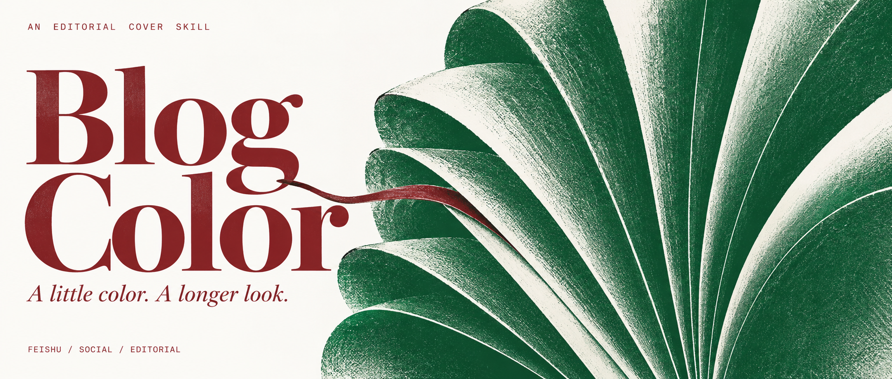
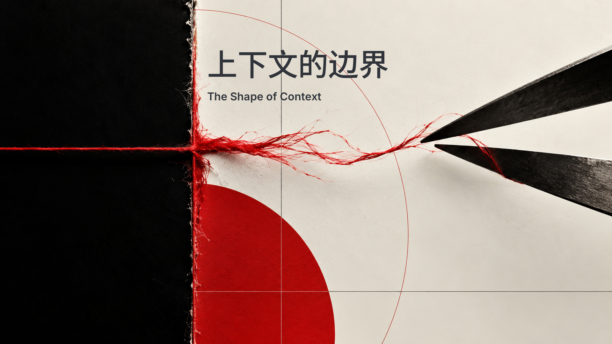
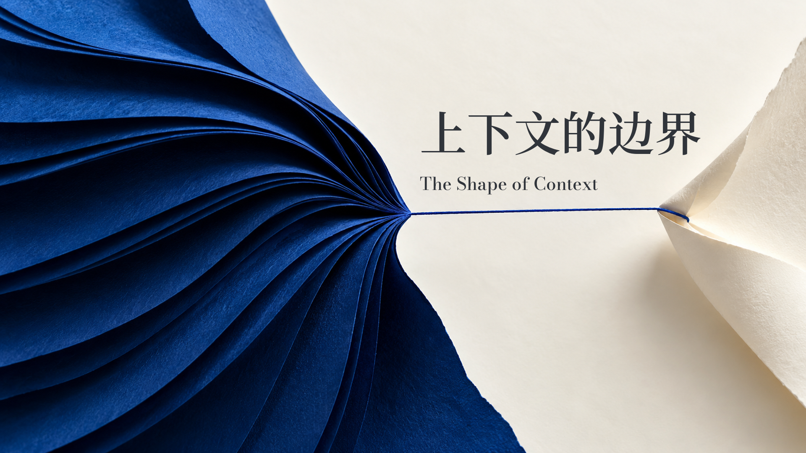
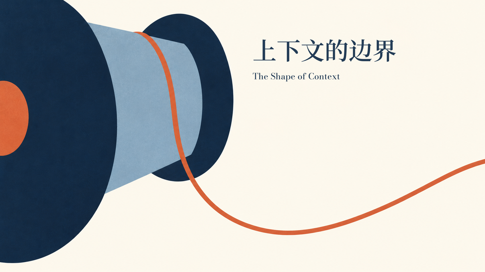
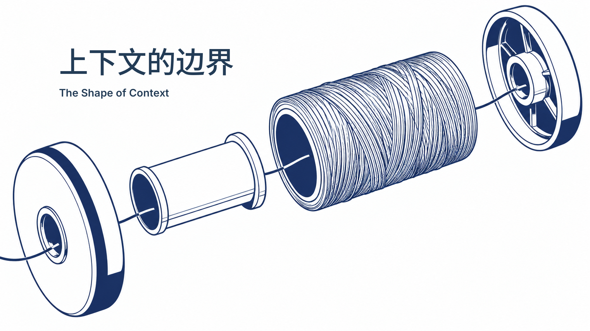
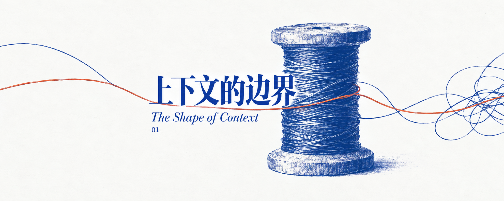
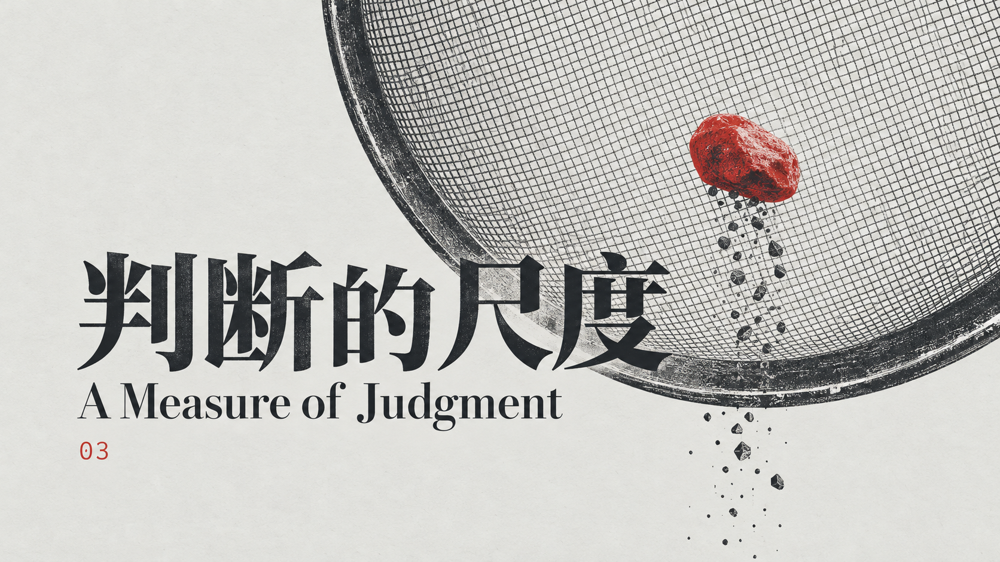

<p align="center">
  
</p>

<p align="center">
  <a href="README.md">English</a> · <strong>简体中文</strong> · <a href="#安装到-codex">安装</a> · <a href="#作品样例">样例</a> · <a href="#中英衬线字体">字体</a>
</p>

# Blog Color · 纸上思考

**为值得细读的文章，做让人停留的封面。**

一个为飞书文档顶部封面与社交媒体横屏封面设计的 Codex skill。用具体物件隐喻、中英字体和精选视觉风格，把 AI、产品、工作方法和其他文章主题转成原创编辑视觉。

一个明确的形态，一点意外的关系，留出能呼吸的纸面。

## Blog Color v2 · 封面风格路由

输入文章后，先获得三套完整方向：风格、色彩分工、字体、构图与文章隐喻。选择或混搭兼容方案后再生成；明确要求直接生成时跳过选择。

八个原创风格模块：艺术印刷、瑞士字体、安静标本、纸艺静物、摄影编辑、受控拼贴、几何插画和结构图版。双色限制只属于艺术印刷；适合时优先使用衬线字体。

正式封面先生成无字画面，再运行 `python3 scripts/render_cover.py --recipe recipe.json`，加载真实字体排版。依赖通过 `python3 -m pip install -r requirements-render.txt` 安装，[排版接口](references/rendering.md)含最小配方。裁切与视觉质量仍需人工核对，几何检查不能证明主体安全。

支持飞书 5:1、2.35:1、16:9、2:1、博客 5:2 和 1200×630。飞书中央 580×240 参考官方建议，其他安全区是设计约定。旧版配色和字体 ID 仍可使用。

## 三套提案示例

以“上下文的边界”为例，路由可以给出：

| | 风格与主图 | 配色 | 字体 | 布局 |
|---|---|---|---|---|
| A · 首推 | 艺术印刷：拉出的线 | `#FAFAF7` / `#2148B8` / `#C65F38` | 思源宋体＋Bodoni Moda | 大物件与留白标题区 |
| B · 备选 | 瑞士字体：剪开的线 | `#FAFAF7` / `#202326` / `#C83232` | 思源黑体＋Inter | 非对称网格与有力标题 |
| C · 探索 | 纸艺静物：折纸与连接线 | `#F5F1E8` / `#2148B8` / `#C65F38` | 思源宋体＋Bodoni Moda | 斜向主体与安静文字区 |

下方为可复用的风格样图，不代表为新需求即时生成的结果。用户指定的文字与品牌色优先。

## Eight directions / 八种方向

### Editorial print / 艺术印刷


### Swiss type / 瑞士字体



### Quiet specimen / 安静标本


### Paper sculpture / 纸艺静物



### Photo editorial / 摄影编辑


### Editorial collage / 受控拼贴


### Geometric illustration / 几何插画



### Structural plate / 结构图版




## 作品样例

### 协作的另一端


*植物绿 × 酒红。让协作通过物件的尺度关系变得可见。*

| 上下文的边界 | 判断的尺度 |
|:---|:---|
|  |  |
| 钴蓝 × 陶土橙 · 保留与释放 | 炭黑 × 信号红 · 筛选与判断 |

以上是原创模型生成的方向样图，不是供反复套用的模板。样图文字由模型绘制，原生尺寸尚未转换为所有平台的目标规格；其中线轴样图**不是已完成的飞书 5:1 导出成品**。

## 安装到 Codex

将仓库克隆到 Codex 的技能目录：

```bash
git clone https://github.com/MavCui/Blog-Color-Skill.git \
  "${CODEX_HOME:-$HOME/.codex}/skills/editorial-wide-cover"
```

GitHub 项目名是 **Blog Color**，安装目录与调用名为 **`editorial-wide-cover`**，入口是根目录的 [SKILL.md](SKILL.md)。目标目录已存在时，应更新现有安装，不直接覆盖克隆。

下一轮 Codex 对话即可使用。默认采用可用的内置生图能力，不需要单独配置图片 API Key。随附字体可由排版工具直接加载，无需安装到系统字体库。

然后直接说：

```text
用 $editorial-wide-cover 给这篇文章做飞书封面。
标题：上下文的边界
使用蓝橙配色和预设的中英衬线字体。
```

## 视觉语言

| 元素 | 方向 |
|:---|:---|
| **主图** | 一个普通物件，或两个存在明确关系的物件 |
| **构图** | 一次大胆裁切、异常尺度或集中的双色交叠 |
| **字体** | 中文宋体／明体与英文衬线，建立清晰的主次 |
| **色彩** | 色彩分工跟随风格，艺术印刷使用两块油墨 |
| **质感** | 线刻、网点、版色分离或克制的复印颗粒 |
| **系列** | 稳定配色、字体系和间距，每篇换一个视觉想法 |

上下文可以通过线的保留与释放表达，评测可以通过筛网的筛选表达。物件来自文章真正讨论的关系，不把任何一种道具变成自动套用的符号。技术文章也沿用艺术编辑方向，不自动出现芯片、机器人或发光网络。

完整规则见 [视觉规范](references/art-direction.md)。

## 三套油墨搭配

| 配色 | 主墨 | 辅墨 | 纸面 | 气质 |
|:---|:---|:---|:---|:---|
| **钴蓝＋陶土橙** | `#2148B8` | `#C65F38` | `#FAFAF7` | 清晰、温和、有观察感；默认主系列 |
| **植物绿＋酒红** | `#008A4B` | `#8F3434` | `#FAFAF7` | 有触感和文化气质；关系与深度随笔 |
| **炭黑＋信号红** | `#30343A` | `#C83232` | `#E9E9E5` | 锋利、有判断；评测与观点 |

艺术印刷主墨通常占实际印刷标记的约 80%，辅墨负责一个有意义的局部：连接点、被留下的物件、选定的一次交叉。纸面不算第三块油墨。

## 中英衬线字体

字体预设含真实文件，不只有字体名称。瑞士与结构图版还支持思源黑体和 Inter。

| 预设 | 中文标题 | 英文标题／副题 | 用途 |
|:---|:---|:---|:---|
| **Editorial** | 思源宋体 SC 半粗 | Bodoni Moda Medium | 主系列的编辑语气 |
| **Literary** | 思源宋体 SC 半粗 | Cormorant Garamond Medium，可用斜体 | 反思、人文与关系 |
| **Critical** | 思源宋体 SC 半粗，以尺度强化力度 | Bodoni Moda SemiBold | 判断、评测与论述 |

IBM Plex Mono 仅作为很小的可选期号，不替代衬线标题。

支持两种路径：模型原生文字按字体特征生成；严格字体一致时，先生成无字底图，再在工具能力允许时加载真实字体排字。把字体名写进 prompt，不代表模型已经载入该字体。交付前检查中文偏旁、英文拼写和笔画完整性。

详见 [字体规范](references/typography.md)、[真实字体与许可](assets/fonts/) 和 [来源校验清单](assets/fonts/manifest.json)。

## 专门为横屏重排

| 预设 | 目标画布 | 核心安全区 |
|:---|:---|:---|
| **飞书** | 2000 × 400 · 5:1 | 中央 580 × 240 |
| **社交宽屏** | 2350 × 1000 · 2.35:1 | 中央约 76% 宽和高 |
| **社交 16:9** | 1920 × 1080 | 中央约 80% 宽／76% 高 |
| **社交 2:1** | 2000 × 1000 | 中央约 76% 宽和高 |

飞书尺寸来自其[官方封面建议](https://www.feishu.cn/hc/zh-CN/articles/990851076781-recommendations-for-covers-in-docs)。其他安全区属于本 skill 的通用设计约定，不代表所有平台的上传要求。

飞书版先安排中央紧凑的信息核心，再向两翼延伸可裁掉的物件局部。社交版重新释放主体与标题的尺度，不把两种画幅互相拉伸。

生成器可能返回不同的原生尺寸或比例。工作流会读取实际文件，区分方向样稿与可上传成品，并说明尚未解决的尺寸问题。详见 [画幅与导出规范](references/formats.md)。

## 使用示例

**一篇文章，一张封面**

```text
用 $editorial-wide-cover 给这篇人机协作文章做封面。
标题：协作的另一端。
绿与酒红配色，Literary 字体，2.35:1 社交横屏。
```

**同一个想法，两种构图**

```text
用 $editorial-wide-cover 做飞书顶部封面和 16:9 社交封面。
保留同一物件隐喻、油墨和字体，按画幅分别重排。
```

**连续文章系列**

```text
用 $editorial-wide-cover 为这三篇文章各做一张封面。
固定主系列配色与 Editorial 衬线预设。
每篇使用不同的物件关系和主视觉动作。
```

**实际字体排版**

```text
用 $editorial-wide-cover，严格加载实际思源宋体与 Bodoni Moda 排字。
先生成无字底图。如果当前工具不能完成精确排版，
给我干净底图、文字位置规格，并说明剩余事项。
```

交付图片、实际使用的完整 prompt，以及记录文字、配色、字体、目标／实际尺寸与检查状态的小型配方文件。默认保存在当前工作区的 `output/editorial-wide-cover/<date>/`。

## 仓库结构

```text
SKILL.md                  生图工作流入口
agents/openai.yaml        Codex 发现与调用配置
references/               视觉、字体、画幅、预设与示例
assets/fonts/             原版字体、OFL 授权与哈希
assets/examples/          三张原创生成方向样图
scripts/inspect_cover.py  PNG/JPEG 文件几何检查
scripts/validate_project.py
                          仓库完整性与回归检查
docs/                     README 封面与实际生图 prompt
```

Python 3.10 或更新版本可运行检查，无需第三方包：

```bash
python3 scripts/validate_project.py
python3 scripts/inspect_cover.py /path/to/cover.png --preset feishu
```

尺寸脚本读取宽高、比例、文件大小和安全区坐标，不做 OCR，也不自动证明视觉质量；实际图片仍需看图检查。

## 致谢与许可

由 [MavCui](https://github.com/MavCui) 创建。印刷视觉语法参考了 [Yan Liu 的 mono-color-skill](https://github.com/yanliudesign/mono-color-skill)，保留来源说明和上游 MIT 许可。未打包上游第三方参考图或作者示例作品。

Skill 指令与代码使用 [MIT](LICENSE)；字体遵循各自原始 [SIL Open Font License](assets/fonts/)；项目原创生成图片单独说明于 [图片资源许可](ASSET-LICENSE.md)。来源与字体下载记录见 [sources](references/sources.md)。

---

<p align="center"><em>一点色彩，让目光多停留片刻。</em><br><a href="README.md">Read the English edition →</a></p>
